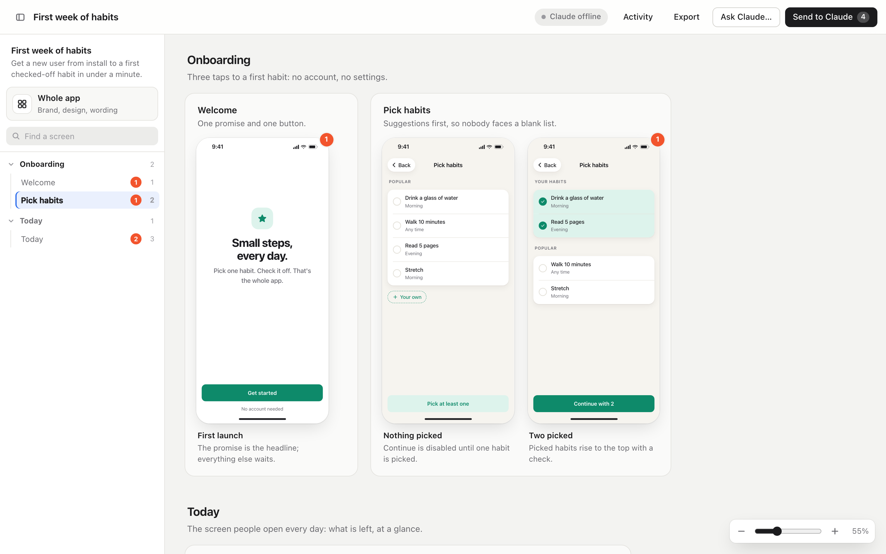
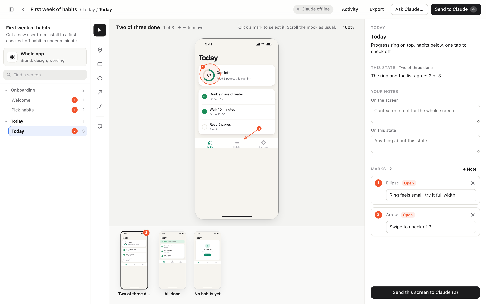
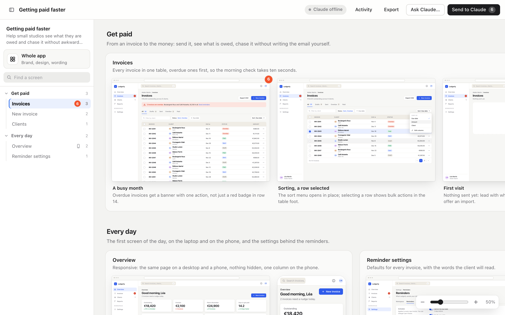

# design-driven-development

A Claude Code plugin for designing an experience before anyone builds it.
Claude writes HTML mocks of every screen and state onto a board in your browser; you mark them up, background workers revise them, and the result is exported into your repo as a spec.





## What it does

Describe what you want ("let's design how onboarding works", "mock up the settings screen"). Claude writes **mocks**: static HTML screens for the product's **device** (a phone, a tablet, a desktop web app, or any size), one file per **state**, with realistic sample data in your product's language and look. They're laid out on a **board**, every flow, screen and state side by side, each with Claude's **intent** beside it: why it looks like this and what it decides.

You mark them up:
- **draw** pins, boxes, ellipses, arrows and freehand on any state, each with a note;
- **write** your own context for a screen or a state;
- **ask** for anything else ("add a state where nothing is saved yet");
- **ask for the whole app or a flow** ("make it feel warmer", "try a bolder type scale", "rename Drill to Practice everywhere"), and write a **design direction** every such request carries.

Press **Send to Claude**. Each screen with marks becomes a job, a background subagent revises it, and the board reloads the mocks as they change while you keep looking. Press **F** on a state to see it truly full screen, edge to edge, with a toolbar you can drag anywhere, and keep marking it up. When the experience is right, press **Export** and send "export the spec" (add anything else you want from the handoff, like "…and break the work into epics and stories"), or say it to Claude.

## Install

In Claude Code:

```
/plugin marketplace add crathgeb/design-driven-development
/plugin install design-driven-development@design-driven-development
```

## Quick start

From your product's repo:

```
/design-driven-development "my app"
```

or just ask: "mock up the settings screen", "let's design the checkout experience", "resume the onboarding design", "export the spec". The board opens at `http://127.0.0.1:4490/` (the next free port if that's taken).

## The loop

1. **Claude reads** the conversation and your repo (README, glossary, product plan, existing screens) and asks only what blocks a first board.
2. **Claude authors the board**: flows → screens → states, covering the hard states (empty, first-time, error, long content, keyboard up, offline…), with one sample cast across every screen. Big boards are written by parallel subagents, one screen each, all from the same kit.
3. **Claude serves it and connects**: the board shows **Claude connected**.
4. **You mark it up** and press **Send to Claude**. One job per screen; jobs on different screens run in parallel. Each job's context pack holds the screen, its states, your marks with the element each one points at, and the rules, so a fresh worker can act on it alone.
5. **The board follows**: changed mocks reload with a highlight, the Activity list shows each job's summary, and the files a job changed are kept in `history/` first.
6. Repeat until it's right, then **Export** from the board (or say "export the spec").

If the session ends, nothing is lost: marks save as you make them, and jobs you send wait until Claude connects again.

## Devices: phone, tablet, desktop, or any size



Each project is designed for a **device**, which Claude picks from the product (a web app or dashboard → desktop; an iOS or Android app → phone) and asks about only when it's unclear:

| Device | Size (CSS pixels) | On the board |
|---|---|---|
| `phone` | 390×844 | a rounded phone screen |
| `tablet` | 820×1180 | a squarer screen |
| `laptop` | 1280×800 | a browser window |
| `desktop` | 1440×900 | a browser window |
| `WxH`, e.g. `1920x1080` | any size from 200 to 4000 | a plain frame |

Any screen or state can have its own device, so one board holds a **responsive design**: a screen with a desktop state and a phone state side by side. A state's device beats its screen's, which beats the project's. Frames are scaled to sit tidily together on the board; the focus view fits any size, zooms (Fit, −, +, 100%), and your marks stay on what they point at at any size.

```bash
node scripts/ddd.mjs init "Billing" --device desktop          # or phone, tablet, laptop, 1366x768
node scripts/ddd.mjs set-device billing laptop                # change the project's default
node scripts/board.mjs billing add-state --screen overview --id phone --title "On a phone" --device phone
node scripts/board.mjs billing update --screen overview --state phone --device inherit   # back to the default
```

## Whole-app and flow requests, and the theme

The sidebar (`[` to hide it) lists every flow and its screens, with open marks and work in progress on each. Its **Whole app** item opens a panel for requests that apply to every screen or to one flow, and for the **design direction**: your note on brand, tone, type and colour, carried by every such request.

A whole-app or flow request is one job that has its screens to itself: it waits for screen jobs running on them, and screen jobs sent after it wait for it. Its worker changes the project's **`theme.css`** first, then only the mocks that must change.

Every mock is built from a small **kit**, so screens from different workers look like one app: `kit/mock.css` for touch screens (status and nav bars, cards, decks, lists, chips, buttons, segmented controls, banners, sheets, a keyboard) and `kit/desktop.css` for web apps (an app shell with a side nav and top bar, page headers with breadcrumbs, grids, data tables, forms, toggles, tabs, toolbars, menus, dialogs, toasts, a split view, responsive down to a phone), light and dark. Each project restyles the kit in its own `theme.css` (kit variables: colours, fonts, radii), loaded by every mock after the kit, so one change rebrands every screen; mocks never hard-code the brand. `kit/README.md` lists every class; `kit/example.html` and `kit/example-desktop.html` show them all.

## Export

**Export** on the board sends an export job: its worker runs `export.mjs`, writes `spec.md`, and anything else your request asks for (a `plan.md` of epics and stories, say). `export.mjs` writes `<repo>/docs/design/<slug>/`:

```
index.html     the board, read-only, opens from disk
mocks/  kit/   every state, and the kit they use
theme.css      the project's brand
screens/       a PNG per state, at its device's size (with playwright-core)
board.json     flows, screens, states and their intent
notes.json     your notes and marks
spec.md        the experience in words, decisions settled, open questions (written by Claude)
```

Building it is a later session's job, from `spec.md` and the mocks.

## Project layout

Projects live outside your repo until you export them:

```
~/.design-driven-development/projects/<repo>/<slug>/     ($DDD_HOME replaces ~/.design-driven-development)
  project.json   name, goal, product repo, device
  theme.css      the brand: kit variable overrides for every mock
  board.json     flows → screens → states, with intent
  notes.json     your notes, design direction, marks and asks
  mocks/         <screen>--<state>.html
  assets/        images the mocks use
  jobs/          each job and its context pack
  history/       files as they were before each job changed them
  log.jsonl      what happened, one line per event
```

## Requirements

- **Node 18 or later.** Nothing else is needed to design, serve, mark up and export.
- **Optional: `playwright-core` and a headless Chromium**, so Claude can render PNGs of the mocks to check its own work and to include in exports. Without them, screenshots are skipped and the scripts print how to install them:

  ```bash
  npm install --prefix "<plugin folder>"            # installs playwright-core (an optionalDependency)
  node "<plugin folder>/node_modules/playwright-core/cli.js" install --only-shell chromium
  ```

  Claude Code may already have installed `playwright-core` with the plugin; any Chromium playwright downloaded before, or a system Chrome, is used if the matching one is missing. `DDD_PLAYWRIGHT` can point at another `playwright-core` folder.

## How it works

[`docs/claude-as-a-backend.pdf`](docs/claude-as-a-backend.pdf) describes the architecture: Claude starts the server and the listener, and each request flows from the browser to a job, a background worker, and back.

## How it differs from plan-maker

| | Starts from | For |
|---|---|---|
| **plan-maker** | a document | reviewing and revising plans, guides and references |
| **design-driven-development** | an idea | an experience that doesn't exist yet, and the intent behind each screen and state |

## Scripts

The skill drives these; you rarely need them yourself.

```bash
node scripts/ddd.mjs init "<name>" [--goal "…"] [--device <device>] | set-device <project> <device> | serve <project> | list | path <slug>
node scripts/board.mjs <project> show | add-flow | add-screen | add-state | update | move | remove-state | remove-screen | remove-flow   # --device on add-screen, add-state, update
node scripts/listen.mjs <project>                       # Claude's listener, under the Monitor tool
node scripts/listen.mjs <project> --state working --message "Updating 2 screens"
node scripts/job.mjs <project> start | done | fail <job-id>
node scripts/shoot.mjs <project>                        # PNG of every state, at its device's size
node scripts/export.mjs <project> [--out <dir>]
```

The design and file formats are in [`docs/design.md`](docs/design.md). Tests: `npm test`.

## Formerly design-first-spec

Before 0.2.0 this plugin was called design-first-spec. Projects in `~/.design-first-spec/` keep working (they're used until `~/.design-driven-development/` exists; move them with `mv ~/.design-first-spec ~/.design-driven-development`), and `DFS_*` environment variables are still read. See [`CHANGELOG.md`](CHANGELOG.md).

## License

MIT, © 2026 Chris Rathgeb. See [`LICENSE`](LICENSE).
